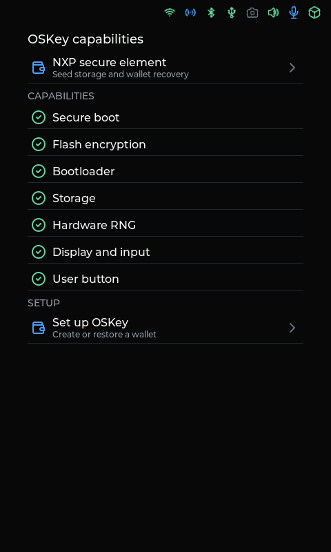
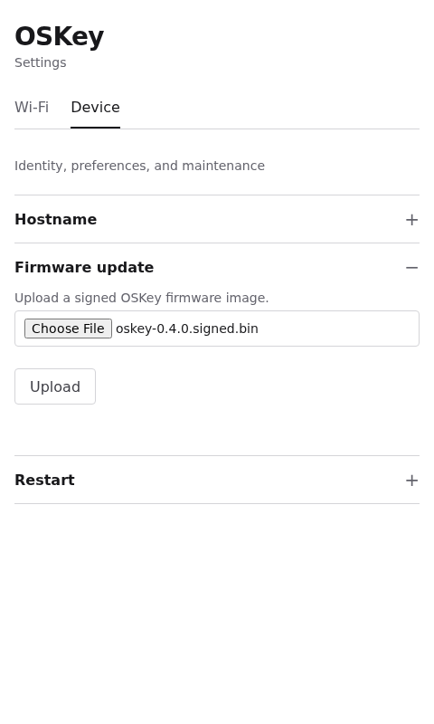
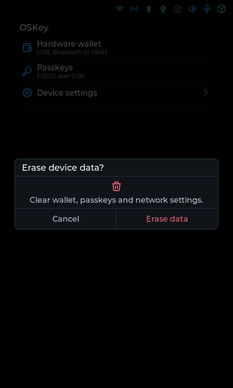

<!-- SPDX-License-Identifier: MPL-2.0 -->

# 固件快速写入指南

本指南适用于 ESP32 系列开发板。首次写入、普通固件重刷与 MCUboot 签名更新需要使用各自对应的镜像和地址。已启用 Secure Boot 或 Flash 加密的设备，请按[签名固件更新说明](../start/firmware-update.md)操作。

[快速使用](../start/README_zh.md) · [编译指南](../start/compile_zh.md) · [产品展示](../showcase/README.md)

## 选择开发板与固件

从 [Releases](https://github.com/butterfly-community/oskey-firmware/releases) 选择与开发板匹配的固件，并阅读该版本的烧录说明。文件名和配置对应仓库中的 [`build.ts`](../../build.ts)，例如：

| 配置名 | 硬件与主要接口 |
| --- | --- |
| `esp32s3_devkitc` | ESP32-S3 DevKitC，持久存储与 UART 钱包通信 |
| `esp32s3_devkitc_fido2` | ESP32-S3 DevKitC，USB FIDO2 |
| `lichuang_szpi_s3` | 立创 ESP32-S3，屏幕、摄像头、音频、IMU 与 SD 卡 |
| `lichuang_szpi_s3_webusb` | 立创 ESP32-S3 外设配置，增加 USB 钱包通信 |

发布构建将 Zephyr 产物按配置名保存到 `boards/build/`。文件扩展名为 `.bin` 不代表它可以通用于所有开发板、Flash 布局或更新通道。

## 首次写入或普通固件重刷

本地构建时，按[编译指南](../start/compile_zh.md)在同一个 shell 中加载 Python 虚拟环境、Zephyr 环境和 ESP Rust 工具链。使用与构建对应的目录烧录，例如：

```sh
west flash -d build/esp32s3
```

立创屏幕与外设示例对应 `west flash -d build/lichuang`。这些命令适用于编译指南中的普通开发配置；MCUboot 安装请使用其专门步骤。

使用预编译固件或浏览器烧录工具时，按该版本说明选择镜像及 Flash Address。只有发布说明明确该文件是从 `0x0` 写入的完整镜像时，才使用 `0x0`。缺少地址或布局说明时，先按编译指南自行构建并用 `west flash` 烧录。

写入后退出烧录工具并重启设备，进入 **OSKey capabilities** 或已有钱包的解锁页。继续按[快速使用指南](../start/README_zh.md)完成 PIN 设置、钱包创建或恢复。



## MCUboot 签名更新

已安装 MCUboot 的设备使用与现有引导程序密钥匹配的 `zephyr.signed.bin`。支持的更新通道包括认证蓝牙、UART 和设备本地浏览器管理页面；具体通道取决于固件配置。

启用 Wi-Fi 和 MCUboot 后，在设备管理页面的 **Firmware update** 中上传签名镜像，再重启安装。签名验证、版本保护、首次安装布局，以及 Zephyr 和 Espressif 两种 MCUboot 端口的完整步骤见[固件更新说明](../start/firmware-update.md)。



签名应用镜像只包含应用，不能作为完整镜像直接写入 `0x0`。已完成生产安全配置的设备应使用 MCUboot 更新应用，避免清空 Flash 或重新写入明文镜像。

## 重置钱包

在 **Device settings** 选择 **Erase wallet**，再确认 **Erase data**。这会清除钱包、通行密钥和网络设置并重启，无需通过擦除整片 Flash 来重置，也无需重新烧录固件。操作前请备份助记词与助记词口令。



使用 NXP A5000 时，清除还涉及芯片内的钱包对象和独立擦除凭据，详见 [NXP 安全芯片说明](../security/nxp-a5000.md)。
