<!-- SPDX-License-Identifier: MPL-2.0 -->

[English](README.md) · [编译指南](compile_zh.md) · [产品展示](../showcase/README.md)

# 快速使用

本指南对应当前触摸屏界面。实际页面、连接方式和外设取决于开发板与固件配置。截图使用演示数据，文档中展示的助记词不能用于真实钱包。

## 准备固件

按照[编译指南](compile_zh.md)为开发板构建并烧录固件，或按 [Releases](https://github.com/butterfly-community/oskey-firmware/releases) 中对应预编译固件的说明操作。ESP32 开发板另见[固件快速写入指南](../board/README_zh.md)。使用 MCUboot 的设备请参考[签名固件更新](firmware-update.md)。

首次启动时查看 **OSKey capabilities**，选择 **Set up OSKey**。没有屏幕的开发板通过固件已启用的连接方式，由主机应用操作。

## 创建或恢复钱包

1. 设置并确认钱包 PIN。设备界面要求至少八个字符，包含大写字母、小写字母、数字和符号。
2. 选择 **Generate recovery phrase** 生成助记词，或选择 **Import recovery phrase** 导入已有助记词。
3. 创建新钱包时选择 **12 words**、**18 words** 或 **24 words**，再选择熵生成方式。相关模块可用时，硬件随机数可结合触摸、运动、摄像头和麦克风输入。详细机制见[助记词熵说明](../mnemonic-entropy.md)。
4. 按顺序离线抄写助记词，选择 **I saved the recovery phrase**，再次输入助记词进行核对。恢复已有钱包时，在 **Import wallet** 中按顺序输入原有英语助记词。
5. 按需填写 **Mnemonic passphrase**，也可留空；非空口令需要再次确认。恢复钱包时应使用原钱包的同一助记词口令。

| 设置钱包 PIN | 选择助记词长度 | 恢复已有钱包 |
| --- | --- | --- |
| 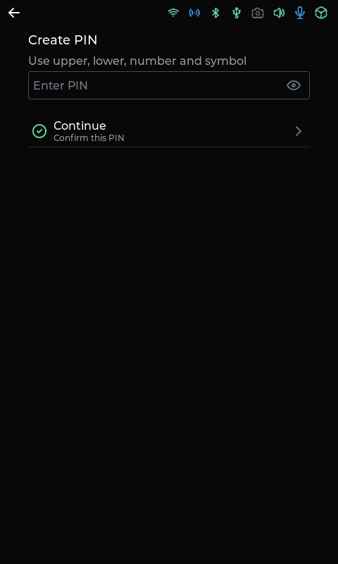 | 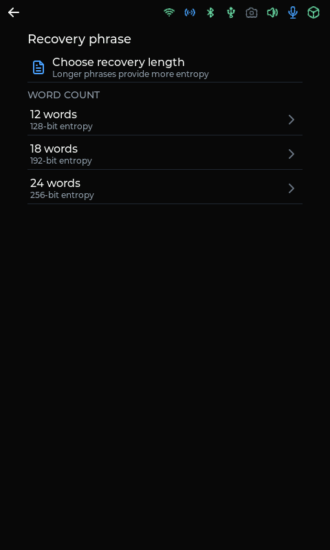 | 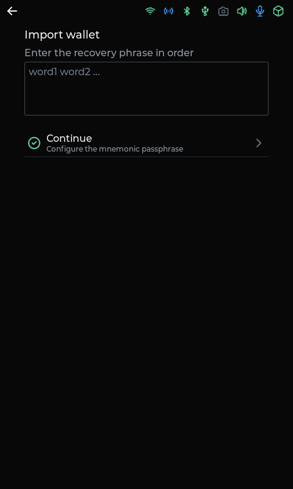 |

请离线保存助记词及助记词口令。钱包 PIN 用于解锁这台设备；助记词口令决定从恢复短语派生出哪个钱包。

默认软件后端在设备中加密保存 seed。启用 NXP A5000 的固件使用安全芯片保存 seed 并验证 PIN。切换存储后端前请阅读 [NXP 说明](../security/nxp-a5000.md)。

## 解锁与连接

已保存钱包的设备重启后，在 **Unlock OSKey** 输入钱包 PIN。首页按启用模块提供 **Hardware wallet**、**Passkeys** 和 **Device settings** 入口。

| 解锁钱包 | 钱包首页 | 连接设置 |
| --- | --- | --- |
| 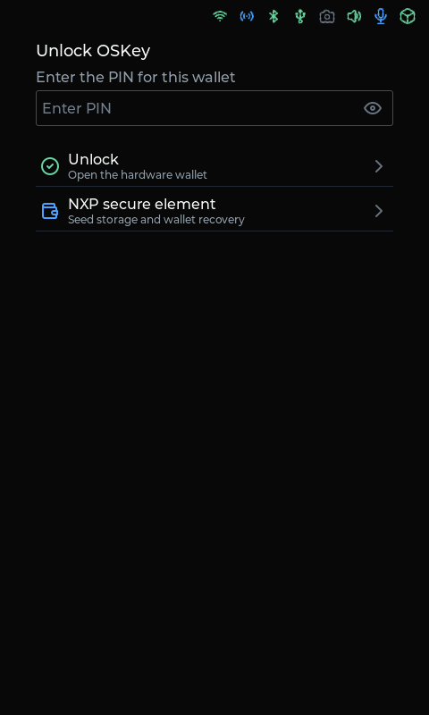 | 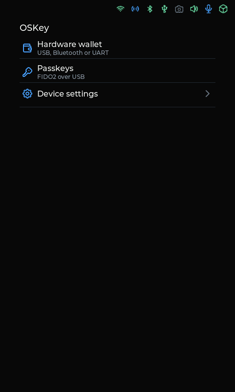 | 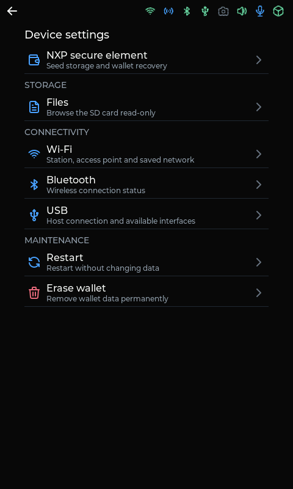 |

根据固件与主机应用支持的接口选择连接方式：

- **UART：** 通过开发板配置的串口进行钱包通信。
- **WebUSB：** 启用 USB 钱包接口后，通过浏览器或应用通信。
- **蓝牙：** 发现 OSKey 并完成认证配对。保持发现过程持续运行，使用设备当前的可解析私有地址（RPA），不要复用缓存地址；保持 **Address privacy** 开启。
- **USB FIDO2：** 启用 FIDO2 后提供通行密钥与安全密钥操作。FIDO PIN 与钱包 PIN 独立，由主机的认证器工具管理。

## 审阅签名请求

连接的钱包应用可以请求 HD 地址派生、以太坊消息签名和交易签名。先在设备上核对私钥访问请求与签名详情，再确认操作。根据开发板配置，可使用触摸或指定的用户按键确认。

| 派生地址 | 消息审阅 | 交易审阅 |
| --- | --- | --- |
|  | 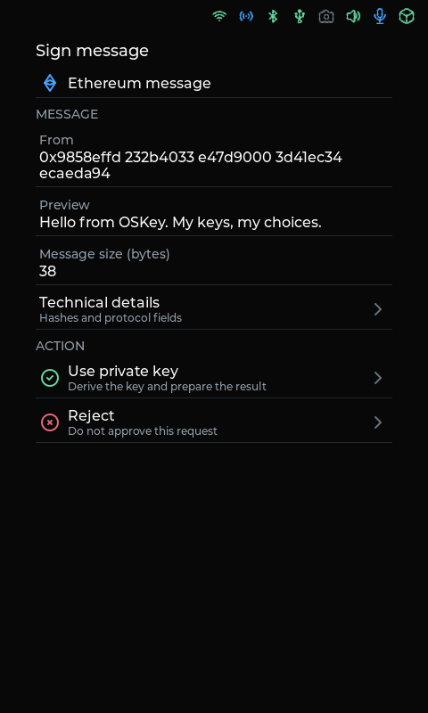 | 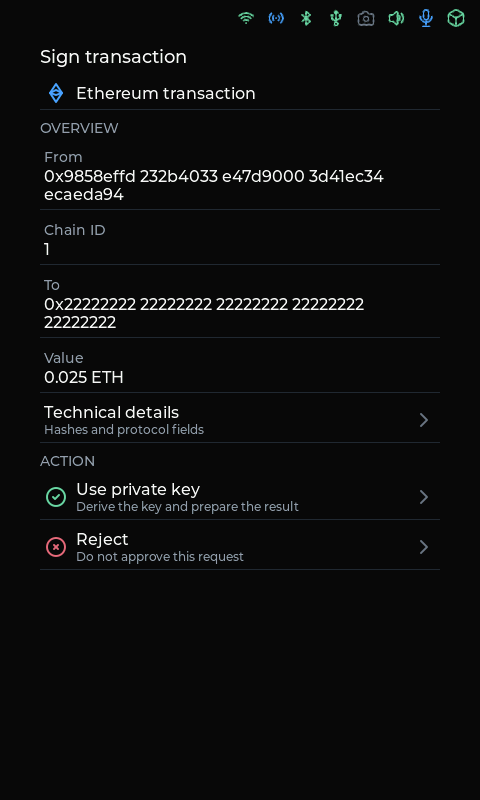 |

[产品展示](../showcase/README.md)还展示了 FIDO2 注册与认证、二维码交互、音频、运动感知和 SD 卡浏览。

## Wi-Fi 与浏览器管理

启用 Wi-Fi 后，在 **Device settings → Wi-Fi** 扫描网络、保存密码并查看当前局域网 IP。也可以连接设备的配网热点，打开设备显示的管理地址。默认热点为 **OSKey-AP**，密码为 `12345678`，地址为 **http://192.168.4.1**，可由固件配置更改。

设备的本地管理页面提供 Wi-Fi 配网、主机名设置和重启操作。启用 MCUboot 的固件还提供签名固件上传；镜像选择与安装步骤见[固件更新](firmware-update.md)。

| 设备 Wi-Fi 状态 | 浏览器配网 | 浏览器设备管理 |
| --- | --- | --- |
| 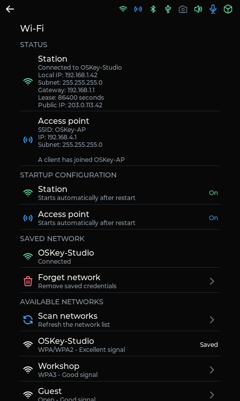 | 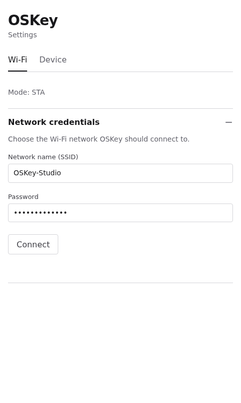 | 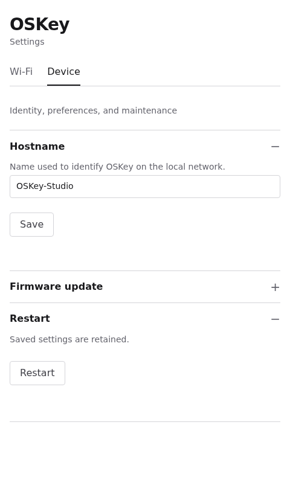 |

## 重启与清除

在 **Device settings** 中选择 **Restart**，保留已保存设置并重启。需要重新初始化钱包时，先备份助记词与助记词口令，再选择 **Erase wallet**，在设备上确认 **Erase data**。该操作清除钱包、通行密钥和网络设置，重启后重新进入初始化流程，无需重刷固件。

出现 **Storage unavailable** 时先选择 **Restart**。存储恢复页面也提供清除入口。NXP 钱包清除和 PIN 次数限制见 [NXP 说明](../security/nxp-a5000.md)。

## 开发与资源

- [Linux 本地模拟器](linux-development.md)
- [签名固件更新](firmware-update.md)
- [立创板音频与麦克风](../board/esp32s3-lichuang-audio.md)
- [立创板 SD 卡支持](../board/esp32s3-lichuang-sd-card.md)
- [IMU 坐标与姿态](../board/imu-coordinate-system.md)
- [内部存储](../storage.md)
- [截图资源清单](../showcase/manifest.json)与[截图工具](../../src/tests/showcase/README.md)

| 微信 | Telegram |
| --- | --- |
|  |  |
